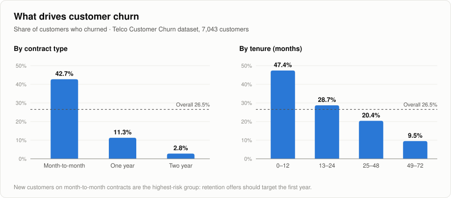
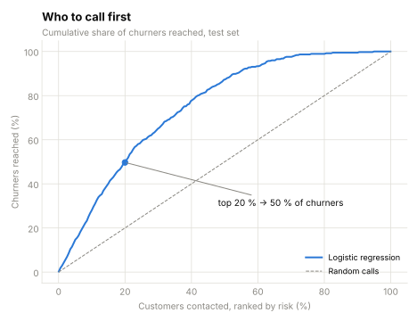
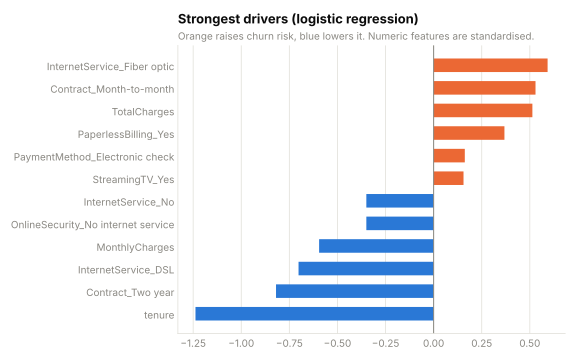

# Telco Customer Churn: who to call before they leave

**Which customers are most likely to cancel, what drives it, and how should a retention team use the model?**
7,043 telecom customers, three models compared with cross-validation, and a targeting recommendation the business can act on.



## Key results

| | |
|---|---|
| **Best model** | Logistic regression: **ROC-AUC 0.842** on held-out customers (5-fold CV on the training data: 0.846 ± 0.013) |
| **Targeting** | Calling the **top 20 % riskiest customers reaches 50 % of all churners**; two out of three customers called would really have left (66 % precision vs. a 26.5 % base rate) |
| **Where churn is** | Month-to-month contracts **42.7 %** vs. two-year contracts **2.8 %**; customers in their first year **47.4 %**; fibre-optic **41.9 %**; electronic-check payers **45.3 %** |
| **Model choice** | Random forest (0.841) and gradient boosting (0.828) were **not** better. The simpler, explainable model wins |

<p>


</p>

## Model comparison

| Model | CV ROC-AUC (mean ± sd) | Test ROC-AUC |
|---|---:|---:|
| **Logistic regression** | **0.846 ± 0.013** | **0.842** |
| Random forest | 0.845 ± 0.010 | 0.841 |
| Gradient boosting | 0.834 ± 0.007 | 0.828 |

The differences are smaller than the cross-validation spread, so there is no reason to pay for a more complex model. Logistic regression is as accurate, faster, and its coefficients can be explained to a retention manager.

## From a score to a decision

A probability is only useful once someone decides who to call. Two views of the same model on the 1,409 test customers:

| Contact the top … | Customers | Churners reached | Of those called, really churning |
|---|---:|---:|---:|
| 10 % | 140 | 28 % | 75 % |
| **20 %** | **281** | **50 %** | **66 %** |
| 30 % | 422 | 65 % | 58 % |
| 40 % | 563 | 78 % | 52 % |

| Probability cut-off | Flagged | Recall | Precision |
|---:|---:|---:|---:|
| 0.3 | 543 | 75 % | 52 % |
| 0.4 | 440 | 67 % | 57 % |
| 0.5 | 319 | 56 % | 66 % |
| 0.6 | 209 | 40 % | 72 % |

The right cut-off depends on what a retention call costs compared with a lost customer. That is a business input, so the notebook shows the trade-off instead of hiding it behind the default 0.5.

## Recommendations

1. **Call the top 20 % by risk first**: half of all churners with a fifth of the effort.
2. **Offer contract upgrades early**: churn is concentrated in new, month-to-month customers.
3. **Investigate the fibre-optic experience**: a premium product with the highest churn points to a price or service problem.
4. **Test before rolling out**: run retention offers with a control group, because the model shows correlation, not cause.

## Data cleaning decisions

- `TotalCharges` has 11 blank values. All 11 are customers with **tenure 0** who have not been billed yet, so the value is set to **0**. Filling with the median (~1,400) would make brand-new customers look like long-standing ones.
- `customerID` is dropped (an identifier, not a feature). No duplicate customers.
- Categorical features are one-hot encoded inside a scikit-learn `Pipeline`, so the test set never leaks into the preprocessing.

## How to run

```bash
pip install -r requirements.txt
jupyter notebook churn_analysis.ipynb
```

The notebook runs top to bottom with relative paths, saves every table to [`results/`](results/) and every chart to [`images/`](images/).

## Project structure

```
├── churn_analysis.ipynb   ← the full analysis, with outputs
├── data/telco_churn.csv   ← IBM Telco Customer Churn (public)
├── results/               ← model comparison, targeting table, thresholds, drivers
├── images/                ← charts used in this README
└── requirements.txt
```

## Limitations

- One snapshot; the data does not say *when* customers left or what offers they received.
- Some features overlap (tenure and total charges), so individual coefficients show direction, not exact effect size.
- A public sample dataset: a real deployment would need re-training and drift monitoring.

## Data

[IBM Telco Customer Churn](https://www.kaggle.com/datasets/blastchar/telco-customer-churn) (public sample dataset from IBM, via Kaggle).

---

**Author:** Sachini Hewahattage · [LinkedIn](https://www.linkedin.com/in/sachini-hewahattage) · [GitHub](https://github.com/Sachinisand)
